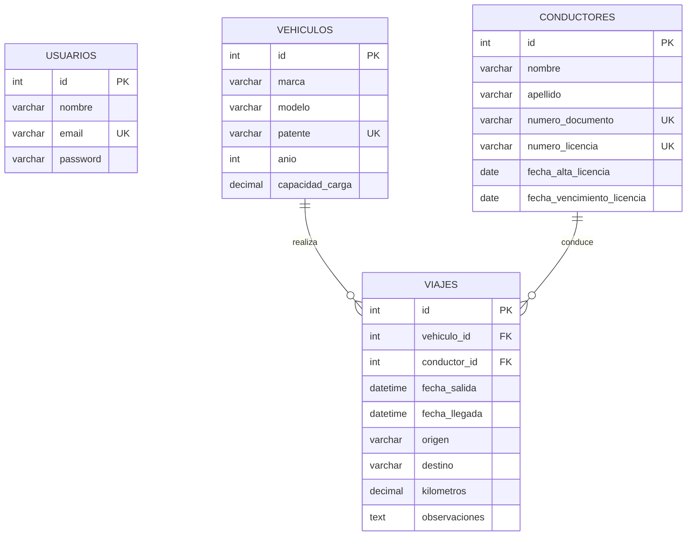

# TP Transporte

Sistema web para gestionar vehículos, conductores y viajes de una empresa de transporte.

## Tecnologías

- Backend: Node.js, Express 5, MySQL (mysql2), Passport (passport-jwt), bcrypt, express-validator.
- Frontend: React con Vite y react-router-dom.

## Instalación

1. Crear la base de datos: abrir `backend/database/schema.sql` en MySQL Workbench y ejecutarlo completo.
2. Backend: copiar `backend/.env.example` a `backend/.env` y completar los datos de MySQL y `JWT_SECRET`. Luego, dentro de `backend`: `npm install` y `npm run dev`.
3. Frontend: crear `frontend/.env` con `VITE_API_URL=http://localhost:3000/api`. Luego, dentro de `frontend`: `npm install` y `npm run dev`.
4. Abrir `http://localhost:5173`.

## Diagrama de entidad-relación

## Decisiones de diseño

- La tabla `viajes` resuelve la relación muchos a muchos entre vehículos y conductores.
- `UNIQUE` en email, patente, documento y licencia para evitar duplicados desde la base.
- Sin `ON DELETE CASCADE`: no se puede borrar un vehículo o conductor con viajes, así no se pierde el historial (el backend responde 400).
- `DECIMAL` para kilómetros y capacidad de carga, para evitar errores de redondeo.
- Contraseñas con bcrypt; JWT con expiración de 4 horas.
- Rutas protegidas con Passport (`passport-jwt`) y validación con `express-validator`.
- Un viaje con un conductor de licencia vencida se rechaza con 403.